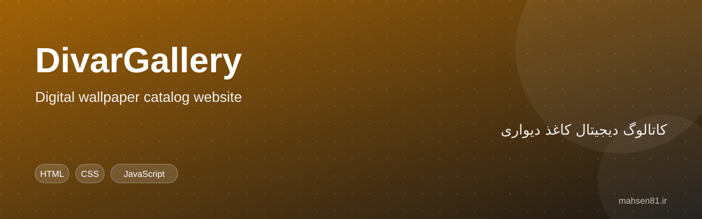

<!-- gen:header -->
<p align="center"></p>

<h1 align="center">DivarGallery</h1>
<p align="center"><b>کاتالوگ دیجیتال کاغذ دیواری</b><br><i>Digital wallpaper catalog website</i></p>
<p align="center">  </p>

<div dir="rtl">

## ✨ امکانات

- آلبوم‌ها و صفحه‌ی محصول
- بدون نیاز به سرور
- طراحی شیک و واکنش‌گرا

</div>

## 🚀 Quick start

```bash
python -m http.server 8080
```

---

<!-- gen:docs -->
## 📚 مستندات کامل · Full documentation

# دیوارگالری — کاتالوگ کاغذ دیواری

کاتالوگ دیجیتال شرکت کاغذ دیواری **دیوارگالری** — بدون فروش آنلاین، صرفاً برای مشاهده و انتخاب طرح.

## نحوه اجرا

### روش ۱ — باز کردن مستقیم
فایل `index.html` را در مرورگر باز کنید:

```
wallpaper-catalog/index.html
```

### روش ۲ — سرور محلی (پیشنهادی)
برای بارگذاری صحیح تصاویر و اسکریپت‌ها:

```bash
cd wallpaper-catalog
python -m http.server 8080
```

سپس در مرورگر: [http://localhost:8080](http://localhost:8080)

## ساختار پروژه

```
wallpaper-catalog/
├── index.html              # صفحه اصلی
├── product.html            # جزئیات محصول (?code=511)
├── about.html              # درباره ما
├── contact.html            # تماس
├── data/
│   └── products.js         # ۲۰ محصول + دسته‌بندی‌ها
├── archive/
│   ├── albums.html         # آرشیو آلبوم‌ها
│   ├── space.html          # آرشیو فضا
│   ├── location.html       # آرشیو موقعیت
│   ├── color.html          # آرشیو رنگ
│   └── pattern.html        # آرشیو طرح
└── assets/
    ├── css/styles.css
    ├── js/
    │   ├── data.js         # کپی از data/products.js
    │   ├── app.js
    │   ├── parallax.js
    │   └── archive.js
    └── images/
        ├── hero/
        ├── products/
        └── logo.png
```

## دسته‌بندی محصولات

هر محصول در **۵ بعد** برچسب‌گذاری شده:

| بعد | زیر‌دسته‌ها |
|-----|-------------|
| آلبوم‌ها | کروم، وایت، داگلاس |
| فضا | اداری، رسمی، مسکونی |
| موقعیت | اتاق خواب، پذیرایی، آشپزخانه، حمام، راهرو، اتاق کودک |
| رنگ | آبی، سبز، بژ، خاکستری، سفید، طلایی، مشکی |
| طرح | ساده، هندسی، گل‌دار، کلاسیک، مدرن، بافت‌دار |

**مثال:** کد ۵۱۱ → آلبوم کروم / فضا اداری / موقعیت پذیرایی / رنگ آبی / طرح هندسی

## ویژگی‌های طراحی

- رابط کاربری فارسی RTL با فونت Vazirmatn
- پالت رنگی لوکس (طلایی برنجی + زغالی)
- پارالاکس روان با `requestAnimationFrame` و `translate3d`
- هیرو با WebGL shader — fallback خودکار به تصویر ثابت
- فیلتر زیر‌دسته در هر صفحه آرشیو
- واکنش‌گرا برای موبایل و دسکتاپ
- پشتیبانی از `prefers-reduced-motion`

## محصولات نمونه

۲۰ محصول با کدهای ۵۱۱ تا ۵۳۰ در `data/products.js` تعریف شده‌اند.

---

<p align="center">ساخته‌شده توسط <a href="https://mahsen81.ir"><b>محسن جباره‌اصل</b></a> — برنامه‌نویسی، طراحی سایت، ربات و هوش مصنوعی<br>
Built by <a href="https://mahsen81.ir">Mohsen Jabbareh-Asl</a> · ⭐ اگر مفید بود، ستاره بدهید · Need a custom version? <a href="https://mahsen81.ir">Get in touch</a></p>
